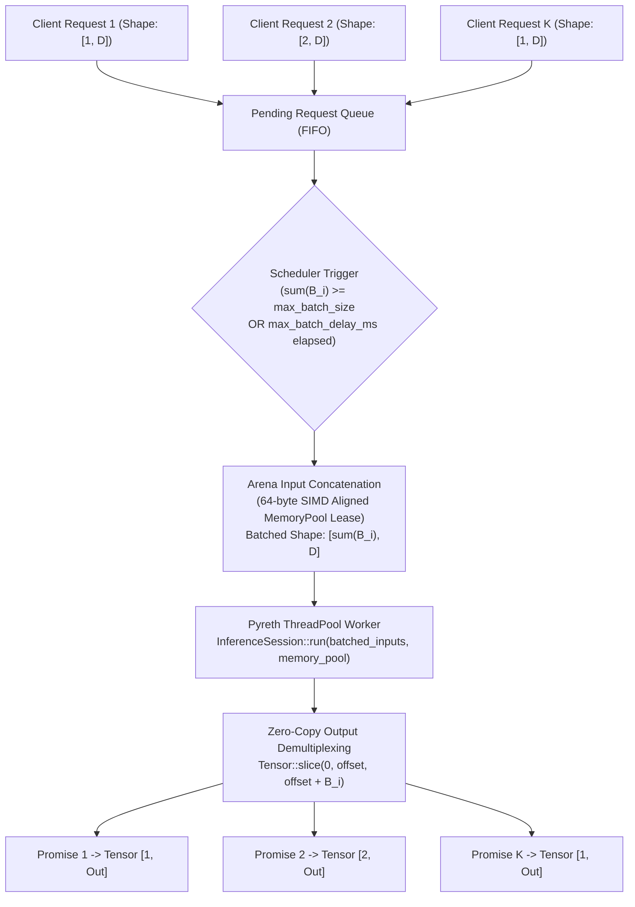
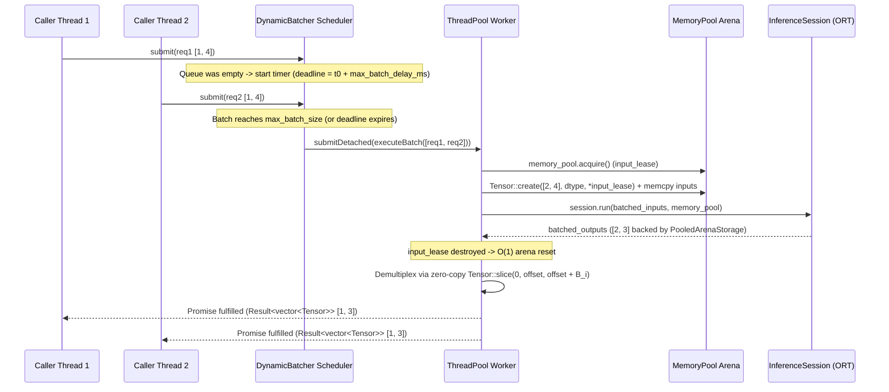

# Dynamic Batching & Request Scheduler Architecture

Pyreth's `DynamicBatcher` (`include/pyreth/dynamic_batcher.hpp`) is a high-throughput request scheduler designed to maximize hardware utilization (CPU SIMD units, Apple Silicon CoreML/AMX, and GPU execution providers) while enforcing strict tail-latency bounds via configurable batching windows.

---

## 1. Architectural Overview

In online serving workloads, individual client requests typically arrive asynchronously with batch size $B = 1$. Dispatching each $B = 1$ request directly to `Ort::Session::Run` incurs per-invocation kernel launch overhead and underutilizes vector/matrix compute units (such as MatMul and Conv2D).

`DynamicBatcher` sits between incoming client requests and `InferenceSession`, coalescing concurrent requests into contiguous batched tensors:



---

## 2. Batch Formation Lifecycle

### 2.1 Admission & Zero-Overhead Validation
When a caller invokes `DynamicBatcher::submit(inputs)` or `DynamicBatcher::run(inputs)`:
1. **Schema Validation**: Inputs are immediately validated on the calling thread against the session's cached `ModelInfo` (`validateInputs`), verifying input count, `DataType`, rank ($\ge 1$), static dimensions, and symbolic dimension consistency.
2. **Batch Axis Check**: Verifies all inputs in the request share the same leading dimension $B_{\text{req}} = \text{shape}[0]$ and that $1 \le B_{\text{req}} \le \text{max\_batch\_size}$.
3. **Storage Pinning**: Shallow `Tensor` handles are copied into the `PendingRequest` entry, pinning any caller `ArenaStorage` or `PooledArenaStorage` until concatenation completes.
4. **Queue Admission**: If `pending_queue.size() >= max_queue_capacity`, the request is rejected immediately with `StatusCode::QUEUE_FULL` without blocking.

### 2.2 Dual-Trigger Scheduler Loop
A dedicated lightweight scheduler `std::jthread` monitors the request queue using two triggers:
- **Size Trigger (`full_batches`)**: As soon as the accumulated sample count $\sum B_i$ of compatible requests at the head of the queue reaches `max_batch_size` (or the next queued request cannot be merged due to exceeding `max_batch_size` or having different dynamic trailing dimensions), the scheduler wakes up immediately—bypassing the timer—and dispatches the batch.
- **Latency Window Trigger (`timeout_batches`)**: When the first request enters an empty queue at $t_0$, the scheduler sets a deadline $t_{\text{deadline}} = t_0 + \text{max\_batch\_delay\_ms}$. If `max_batch_size` is not reached before $t_{\text{deadline}}$, the partial batch is flushed immediately upon deadline expiration to bound P99 tail latency.

### 2.3 Sequence Diagram



---

## 3. Memory Management & Zero-Copy Demultiplexing

1. **Arena-Backed Input Concatenation**:
   - The worker leases a 64-byte aligned `ArenaAllocator` from `MemoryPool` for the batch's concatenated inputs.
   - Each model input is allocated once with shape `[B_total, ...]` and populated via contiguous `std::memcpy` (or `toContiguous` if a caller supplied a strided view).
   - Immediately after `session.run()` finishes, the input arena lease goes out of scope, resetting in $O(1)$ and returning to the `MemoryPool`.
2. **Zero-Copy Output Demultiplexing**:
   - Batched outputs are allocated in a `PooledArenaStorage` lease via `session.run(batched_inputs, *memory_pool)`.
   - Each request $k$ with batch size $b_k$ and row offset $r_k = \sum_{j < k} b_j$ receives `batched_output.slice(0, r_k, r_k + b_k, 1)`.
   - Because slicing along axis 0 with unit step preserves contiguous row-major layout (`isContiguous() == true`), demultiplexing performs **zero memory copies** ($O(1)$ pointer offset).
   - Shared reference counting on `PooledArenaStorage` keeps the output arena alive until all $K$ callers finish consuming their output tensors, after which the arena automatically resets in $O(1)$ and returns to `MemoryPool`.

---

## 4. C++ Usage Guide

### 4.1 Configuring and Creating a `DynamicBatcher`

```cpp
#include <pyreth/pyreth.hpp>
#include <iostream>

int main() {
  pyreth::SessionConfig session_cfg;
  session_cfg.setIntraOpNumThreads(1);  // Avoid oversubscription under batched serving

  auto session = pyreth::InferenceSession::create("model.onnx", session_cfg).value();
  pyreth::ThreadPool pool(4);
  pyreth::MemoryPool mem_pool(16, 1024 * 1024);

  pyreth::DynamicBatcherConfig batch_cfg;
  batch_cfg.setMaxBatchSize(16)
           .setMaxBatchDelayMs(5)
           .setMaxQueueCapacity(1024);

  auto batcher = pyreth::DynamicBatcher::create(session, pool, mem_pool, batch_cfg).value();

  // Asynchronous submission
  auto x1 = pyreth::Tensor::create(pyreth::Shape{1, 4}, pyreth::DataType::Float32).value();
  auto x2 = pyreth::Tensor::create(pyreth::Shape{1, 4}, pyreth::DataType::Float32).value();

  auto h1 = batcher.submit({x1}).value();
  auto h2 = batcher.submit({x2}).value();

  auto out1 = h1.get().value();
  auto out2 = h2.get().value();

  // Inspect runtime telemetry
  auto metrics = batcher.metrics();
  std::cout << "Batches dispatched: " << metrics.batches_dispatched << "\n"
            << "Average batch size: " << metrics.averageBatchSize() << "\n"
            << "Average wait (us):  " << metrics.averageBatchWaitUs() << "\n";
}
```

### 4.2 Tuning `max_batch_size` vs `max_batch_delay_ms`

| Workload Profile | Recommended `max_batch_size` | Recommended `max_batch_delay_ms` | Behavior |
| :--- | :--- | :--- | :--- |
| **Ultra-Low Latency** | `4` – `8` | `1` – `2` ms | Opportunistically batches burst arrivals without adding perceptible queue wait under light load. |
| **Balanced Online Serving** | `16` – `32` | `5` – `10` ms | High hardware occupancy under moderate-to-high concurrency while keeping P99 latency predictable. |
| **Max Throughput / Offline Streaming** | `32` – `64` | `20` – `50` ms | Maximizes `full_batches` ratio and amortizes model execution overhead across large batches. |
